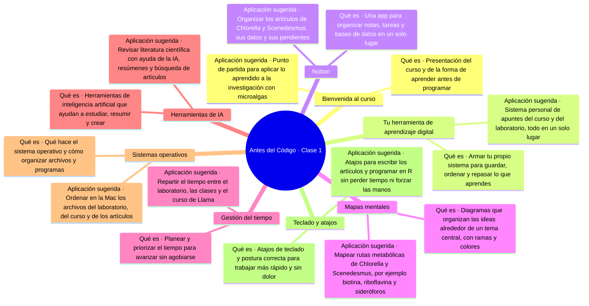

# IA Aplicada con Llama

Apuntes, prácticas y entregas del curso **Inteligencia Artificial Aplicada con Llama** (Meta <> INFOTEC), impartido en la plataforma de DEV.F.

- **Grupo:** G, Cohorte 2
- **Horario:** viernes 18:30–20:30
- **Tutor:** Alexis Vázquez Ramírez
- **Tutorías:** lunes y miércoles 16:00–17:30
- **Plataforma:** [edu.devf.la](http://edu.devf.la)
- **Material de apoyo (copia en Drive):** [IA con Llama - Material de apoyo](https://drive.google.com/drive/folders/1Hqi37OuxUkwIOdzCzTcZLAn0S-0cr7cF)

## Índice

| Carpeta | Contenido |
|---|---|
| [apuntes/clase-1-antes-del-codigo.md](apuntes/clase-1-antes-del-codigo.md) | Apuntes de la Clase 1, Antes del Código (Fundamentos Esenciales) |
| [clase-1/](clase-1/) | Fundamentos de LLMs con modelos Llama |
| [clase-2/](clase-2/) | Prompt Engineering y sistemas RAG |
| [clase-3/](clase-3/) | Fine-tuning con LoRA |
| [clase-4/](clase-4/) | Pipeline completo: RAG + LoRA + despliegue |
| [hackathon-1/](hackathon-1/) | Hackathon 1: Asistente inteligente con Llama |
| [modulo-2-whatsapp/](modulo-2-whatsapp/) | Módulo 2: Agentes conversacionales con Llama y WhatsApp |

## Mapa del curso

- **Fundamentos Esenciales**
  - Clase 1: Antes del Código
  - Clase 2: Antes del Código - Internet
- **Módulo 1: IA Aplicada con Llama**
  - Clase 1: Fundamentos de LLMs con modelos Llama
  - Clase 2: Prompt Engineering y sistemas RAG
  - Clase 3: Fine-tuning con LoRA
  - Clase 4: Pipeline completo
  - Hackathon 1: Asistente inteligente con Llama
- **Módulo 2: Automatización Inteligente con WhatsApp**
  - Agentes conversacionales con Llama 3.1 + WhatsApp

## Mapa mental — Clase 1: Antes del Código

El mapa completo, con la lista de las 8 lecturas en texto, está en
[apuntes/clase-1-antes-del-codigo.md](apuntes/clase-1-antes-del-codigo.md).
La versión visual está en [apuntes/mapa-mental-clase-1.html](apuntes/mapa-mental-clase-1.html).

## Cómo correr un notebook

1. Abrir el archivo `.ipynb` en Google Colab (Archivo → Abrir cuaderno → subir o abrir desde Drive).
2. Activar la GPU gratuita: Entorno de ejecución → Cambiar tipo de entorno de ejecución → **T4 GPU**. Verificar con `!nvidia-smi`.
3. Guardar las credenciales en **Colab Secrets** (icono de la llave, en el panel izquierdo):
   - `GROQ_API_KEY`: llave de la API de Groq.
   - `HF_TOKEN`: token de Hugging Face.
4. Ejecutar las celdas en orden, de arriba a abajo.

Hay dos rutas en el material de apoyo:

- **Versión Groq (Gen 1 y notebooks `Modulo1_Clase*_COMENTADO`):** las llamadas a Llama van por la API de Groq; no se descarga el modelo.
- **Versión Ollama (Gen 2, sesiones 01–05 y 09):** Ollama se instala dentro de Colab, descarga el modelo (por ejemplo `llama3.1:8b`) y lo ejecuta en la GPU gratuita de Colab, sin API key de Groq.

## Seguridad

Las llaves de API (Groq, Hugging Face, OpenAI, Meta/WhatsApp, ngrok) viven
solo en Colab Secrets, nunca en el código ni en el repositorio. El archivo
`.gitignore` bloquea `.env`, `*.pem`, `*.key` y archivos de secretos.

## Entregas

- **Clase 1 — Proyecto: Pon en práctica lo aprendido.** Recurso visual sobre lo
  aprendido (dibujos, mapa mental, colores) + link al recurso digital o fotos de
  los apuntes. El recurso visual es el mapa mental de arriba.
- **Clases 1–4 — Challenges.** Comparador de modelos Llama (Clase 1),
  asistente de políticas con RAG (Clase 2), ajuste de tono con LoRA (Clase 3)
  y pipeline completo (Clase 4).
- **Hackathon 1.** Asistente inteligente con Llama (ejemplo completo: Asistente
  de Biblioteca con RAG y TinyLlama).
- **Módulo 2.** Agente conversacional con Llama 3.1 + WhatsApp (memoria por
  usuario, function calling, webhook con FastAPI y ngrok).
